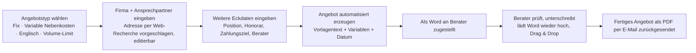

# AngebotsPilot

> The WHAT. Say `/grill` and just talk — the agent listens, fills this in,
> then sharpens it with you. Messy is right. CLAUDE.md is the HOW.

## Goal (1 sentence)
AngebotsPilot erzeugt aus wenigen Eckdaten automatisiert ein unterschriftsreifes Executive-Search-Angebot/Auftragsbestätigung der Headgate GmbH — als Word und PDF, direkt per E-Mail zugestellt.

## Who it is for
Mehrere Berater:innen bei der Headgate GmbH, die Angebote für Executive-Search-Suchaufträge schreiben. Kein Login/Passwort — man ordnet sich beim Anlegen eines Angebots per Namens-Auswahl zu (Dropdown oder Eintippen), daraus ergibt sich die E-Mail-Adresse nach festem Muster.

## What hurts today
Jedes Angebot wird von Hand aus einer von vier Word-Vorlagen zusammengebaut (fixe Nebenkosten / variable Nebenkosten / Englisch / Volume-Limit), Adress- und Honorardaten werden manuell eingetragen, Datum und die richtigen Absätze müssen jedes Mal geprüft werden — zeitaufwändig und fehleranfällig, gerade weil sich nur wenige Felder wirklich unterscheiden.

## Users & Ownership
**Bestätigt:** Offener Zugang, kein Passwort-Login. Alle Berater:innen sehen alle Angebote — ein gemeinsames internes Team-Tool, keine Datentrennung zwischen Personen. Wer ein Angebot erstellt hat, wird als Feld am Angebot gespeichert (Beratername + abgeleitete E-Mail), nicht über einen Account.

Berater:innen sind eine feste, editierbare Stammdaten-Liste (Name + E-Mail): neue Berater können hinzugefügt, ausscheidende deaktiviert werden.

## Primary Workflow (the one path that must work in the demo)

The one path, as a flow. `/grill` draws this — you never edit it by hand.
It renders as boxes and arrows at http://localhost:3000/flow

## Explicitly OUT of scope
- **Bestätigt:** Keine Kundendatenbank/Wiederverwendung — jede Adresse wird pro Angebot frisch recherchiert bzw. eingegeben, nichts wird über Angebote hinweg gespeichert oder vorgeschlagen
- **Bestätigt:** Keine digitale Signatur im Tool — Berater unterschreibt weiterhin selbst (Word öffnen, Signatur einfügen oder ausdrucken/scannen) und lädt die fertige Datei hoch
- **Bestätigt:** Kein Versand direkt an den Kunden aus dem Tool heraus — nur Zustellung an den Berater per Mail, der leitet selbst weiter
- **Bestätigt:** Kein Status-Tracking/Nachfassen (angenommen, abgelehnt, unterschrieben)
- **Bestätigt:** Keine freie Bearbeitung einzelner Vertragsparagraphen im UI — nur die besprochenen strukturierten Felder + die vier Angebotstyp-Varianten

## The Demo
Kein Pitch-Termin nötig — das ist ein internes Hilfswerkzeug als Nebenprojekt, keine Präsentationsaufgabe im Workshop. Sobald es läuft: Angebotstyp wählen, Firma+Ansprechpartner eintippen (Adresse wird vorgeschlagen), restliche Eckdaten ergänzen, Word erhalten, geprüfte/unterschriebene Datei wieder hochladen, fertiges PDF per Mail bekommen.

## Demo Success Criterion (from the intro round, day 1)
Erfolg ist, wenn ich mit wenigen Eingaben ein korrektes, zum gewählten Angebotstyp passendes Angebot als PDF bekomme, ohne die Word-Vorlage je von Hand anzufassen.
