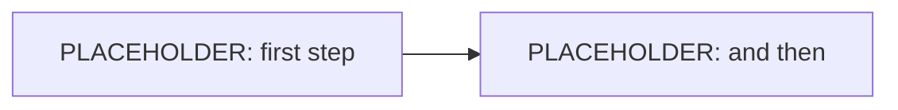

# [PLACEHOLDER: Project Name]

> The WHAT. Say `/grill` and just talk — the agent listens, fills this in,
> then sharpens it with you. Messy is right. CLAUDE.md is the HOW.

## Goal (1 sentence)
[PLACEHOLDER: What does this tool do, for whom?]

## Who it is for
[PLACEHOLDER: Who actually uses this? If that is someone other than you, say so —
everything about people who are not in the room is a guess, and gets marked as one.]

## What hurts today
[PLACEHOLDER: What is annoying right now, in your words. This is the yardstick for
whether the thing you build makes anything better.]

## Users & Ownership
[PLACEHOLDER: Who uses it? What does each user own?]

## Primary Workflow (the one path that must work in the demo)

The one path, as a flow. `/grill` draws this — you never edit it by hand.
It renders as boxes and arrows at http://localhost:3000/flow

## Explicitly OUT of scope
- [PLACEHOLDER: Everything you cut. Cutting is winning.]

## The Demo
[PLACEHOLDER: Written in the rehearsal at the end of /grill — what you show tomorrow
at four, in what order, and what you answer when someone asks "und was bringt das?"
Three to five lines, your words.]

## Demo Success Criterion (from the intro round, day 1)
[PLACEHOLDER: "It's a success for me when …" — gets called up again at the demo.]
